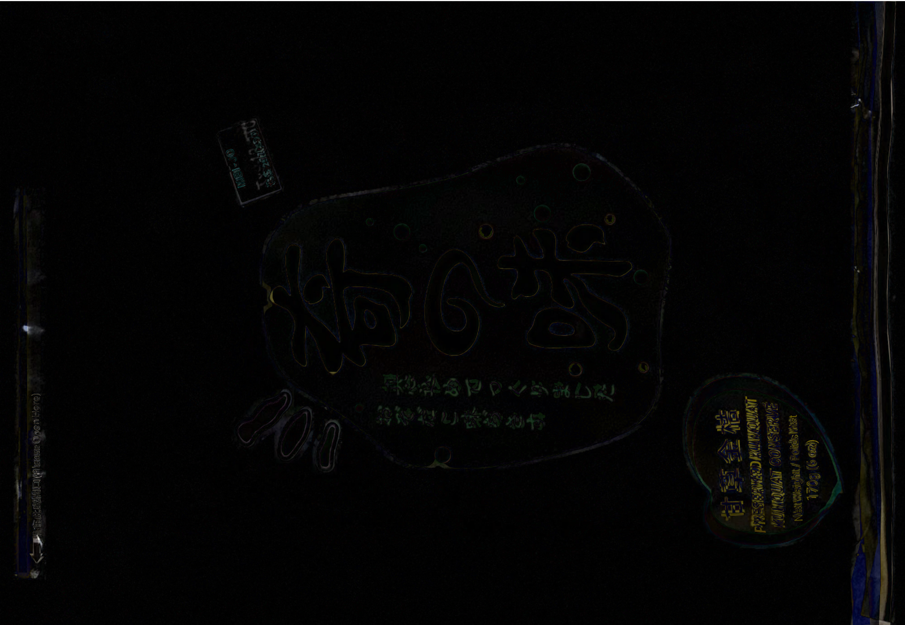
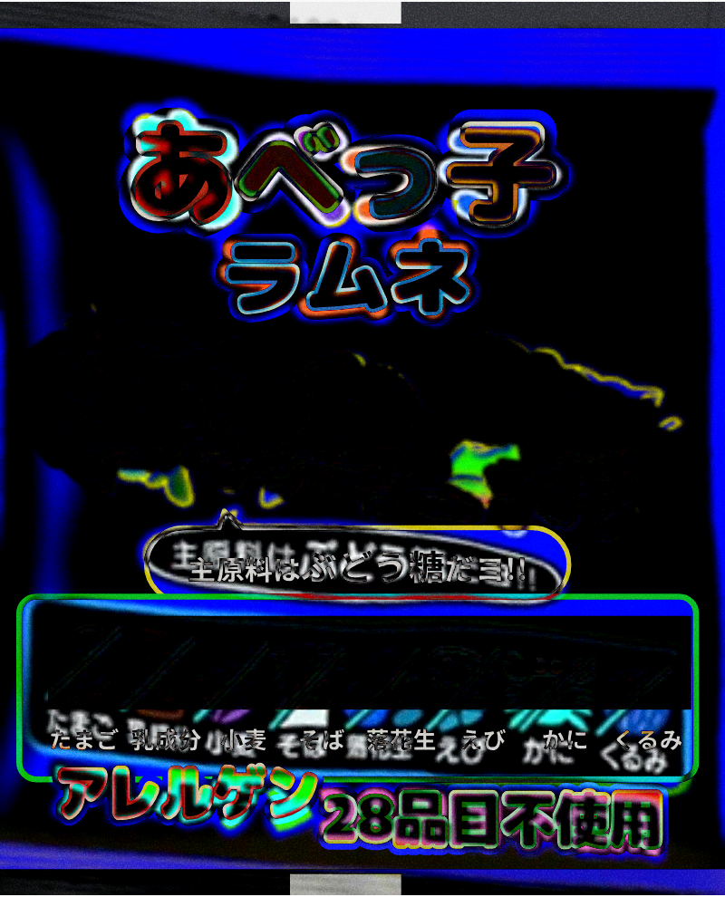
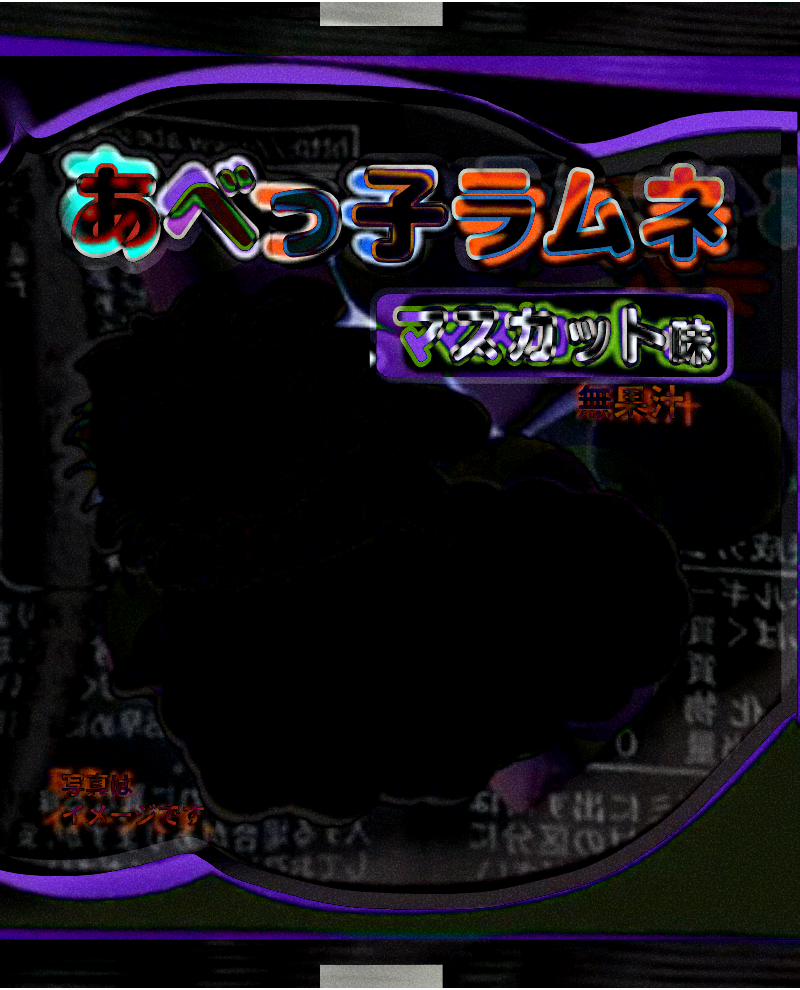
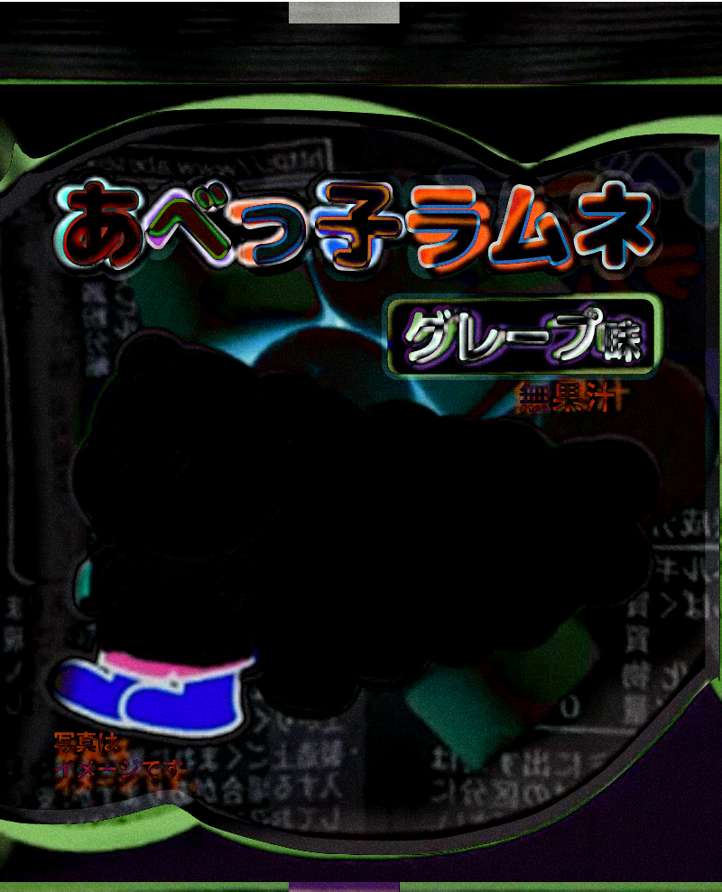
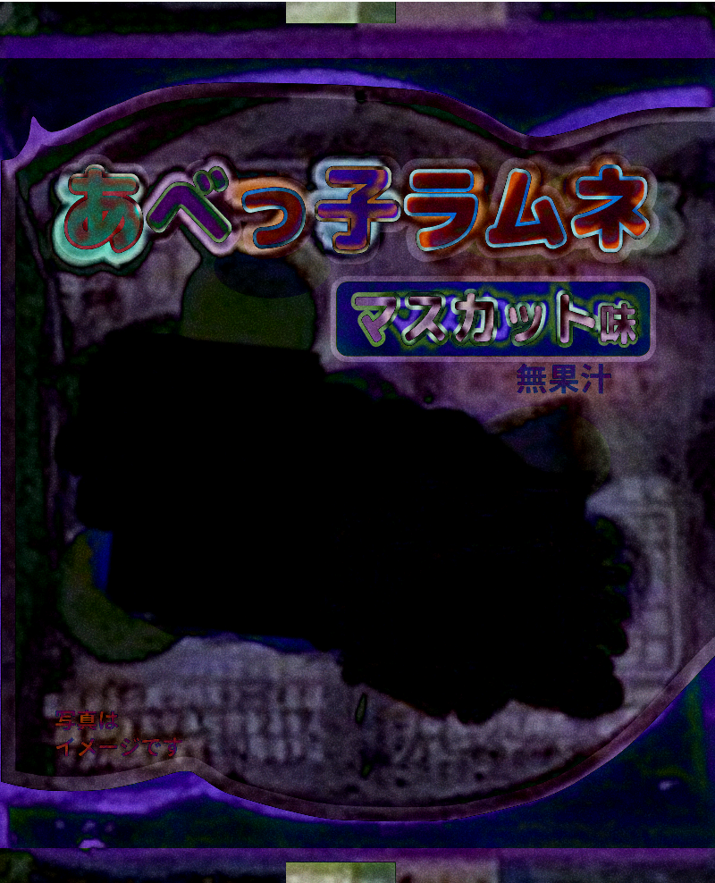
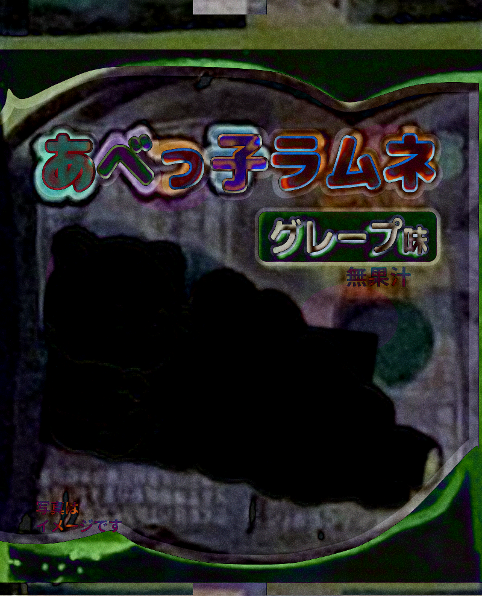
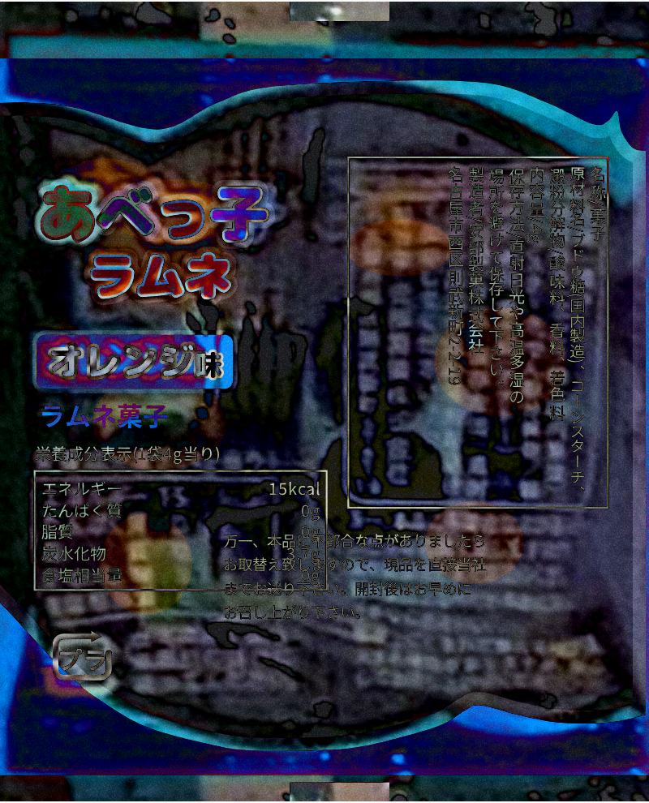
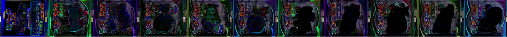
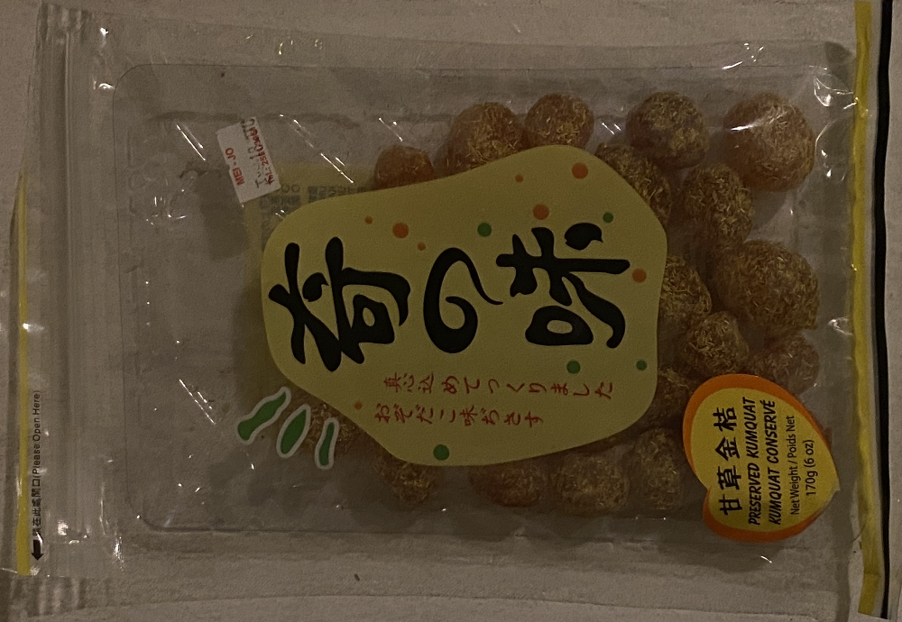

<SuzunoBag item="kumquat" :difference="false" :opacity="100" />

<SuzunoBag item="kumquat" difference="false" />

<SuzunoBag item="kumquat" />

<SuzunoRamune item="header" difference="false" opacity="0" class="m-0" />
<SuzunoRamune item="header" :difference="false" :opacity="100" class="m-0" />
<SuzunoRamune item="header" difference="false" class="m-0" />
<SuzunoRamune item="header" class="m-0" />

<SuzunoRamune item="header" face="back" difference="false" opacity="0" class="m-0" />
<SuzunoRamune item="header" face="back" :difference="false" :opacity="100" class="m-0" />
<SuzunoRamune item="header" face="back" difference="false" class="m-0" />
<SuzunoRamune item="header" face="back" class="m-0" />

<SuzunoRamune item="strawberry" difference="false" opacity="0" class="m-0" />
<SuzunoRamune item="strawberry" :difference="false" :opacity="100" class="m-0" />
<SuzunoRamune item="strawberry" difference="false" class="m-0" />
<SuzunoRamune item="strawberry" class="m-0" />

<SuzunoRamune item="muscat" difference="false" opacity="0" class="m-0" />
<SuzunoRamune item="muscat" :difference="false" :opacity="100" class="m-0" />
<SuzunoRamune item="muscat" difference="false" class="m-0" />
<SuzunoRamune item="muscat" class="m-0" />

<SuzunoRamune item="peach" difference="false" opacity="0" class="m-0" />
<SuzunoRamune item="peach" :difference="false" :opacity="100" class="m-0" />
<SuzunoRamune item="peach" difference="false" class="m-0" />
<SuzunoRamune item="peach" class="m-0" />

<SuzunoRamune item="grape" difference="false" opacity="0" class="m-0" />
<SuzunoRamune item="grape" :difference="false" :opacity="100" class="m-0" />
<SuzunoRamune item="grape" difference="false" class="m-0" />
<SuzunoRamune item="grape" class="m-0" />

<SuzunoRamune item="orange" difference="false" opacity="0" class="m-0" />
<SuzunoRamune item="orange" :difference="false" :opacity="100" class="m-0" />
<SuzunoRamune item="orange" difference="false" class="m-0" />
<SuzunoRamune item="orange" class="m-0" />

<SuzunoRamune item="strawberry" pose="2" difference="false" opacity="0" class="m-0" />
<SuzunoRamune item="strawberry" pose="2" :difference="false" :opacity="100" class="m-0" />
<SuzunoRamune item="strawberry" pose="2" difference="false" class="m-0" />
<SuzunoRamune item="strawberry" pose="2" class="m-0" />

<SuzunoRamune item="muscat" pose="2" difference="false" opacity="0" class="m-0" />
<SuzunoRamune item="muscat" pose="2" :difference="false" :opacity="100" class="m-0" />
<SuzunoRamune item="muscat" pose="2" difference="false" class="m-0" />
<SuzunoRamune item="muscat" pose="2" class="m-0" />

<SuzunoRamune item="peach" pose="2" difference="false" opacity="0" class="m-0" />
<SuzunoRamune item="peach" pose="2" :difference="false" :opacity="100" class="m-0" />
<SuzunoRamune item="peach" pose="2" difference="false" class="m-0" />
<SuzunoRamune item="peach" pose="2" class="m-0" />

<SuzunoRamune item="grape" pose="2" difference="false" opacity="0" class="m-0" />
<SuzunoRamune item="grape" pose="2" :difference="false" :opacity="100" class="m-0" />
<SuzunoRamune item="grape" pose="2" difference="false" class="m-0" />
<SuzunoRamune item="grape" pose="2" class="m-0" />

<SuzunoRamune item="orange" pose="2" difference="false" opacity="0" class="m-0" />
<SuzunoRamune item="orange" pose="2" :difference="false" :opacity="100" class="m-0" />
<SuzunoRamune item="orange" pose="2" difference="false" class="m-0" />
<SuzunoRamune item="orange" pose="2" class="m-0" />

<SuzunoRamune item="strawberry" face="back" difference="false" opacity="0" class="m-0" />
<SuzunoRamune item="strawberry" face="back" :difference="false" :opacity="100" class="m-0" />
<SuzunoRamune item="strawberry" face="back" difference="false" class="m-0" />
<SuzunoRamune item="strawberry" face="back" class="m-0" />

<SuzunoRamune item="muscat" face="back" difference="false" opacity="0" class="m-0" />
<SuzunoRamune item="muscat" face="back" :difference="false" :opacity="100" class="m-0" />
<SuzunoRamune item="muscat" face="back" difference="false" class="m-0" />
<SuzunoRamune item="muscat" face="back" class="m-0" />

<SuzunoRamune item="peach" face="back" difference="false" opacity="0" class="m-0" />
<SuzunoRamune item="peach" face="back" :difference="false" :opacity="100" class="m-0" />
<SuzunoRamune item="peach" face="back" difference="false" class="m-0" />
<SuzunoRamune item="peach" face="back" class="m-0" />

<SuzunoRamune item="grape" face="back" difference="false" opacity="0" class="m-0" />
<SuzunoRamune item="grape" face="back" :difference="false" :opacity="100" class="m-0" />
<SuzunoRamune item="grape" face="back" difference="false" class="m-0" />
<SuzunoRamune item="grape" face="back" class="m-0" />

<SuzunoRamune item="orange" face="back" difference="false" opacity="0" class="m-0" />
<SuzunoRamune item="orange" face="back" :difference="false" :opacity="100" class="m-0" />
<SuzunoRamune item="orange" face="back" difference="false" class="m-0" />
<SuzunoRamune item="orange" face="back" class="m-0" />

<SuzunoRamuneStrip difference="false" opacity="0" />

<SuzunoRamuneStrip />

<SuzunoRamuneStrip face="back" difference="false" opacity="0" />

<SuzunoRamuneStrip face="back" />

<SuzunoRamuneStrip :order="['grape', 'peach']" count="6" />

<SuzunoCandySnake />
