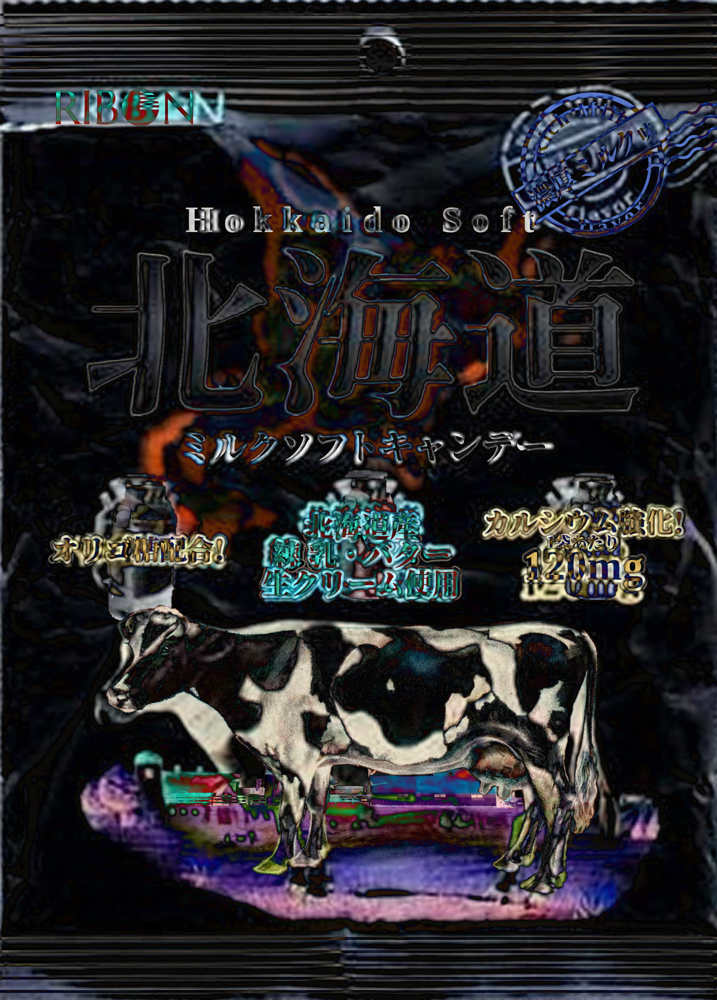
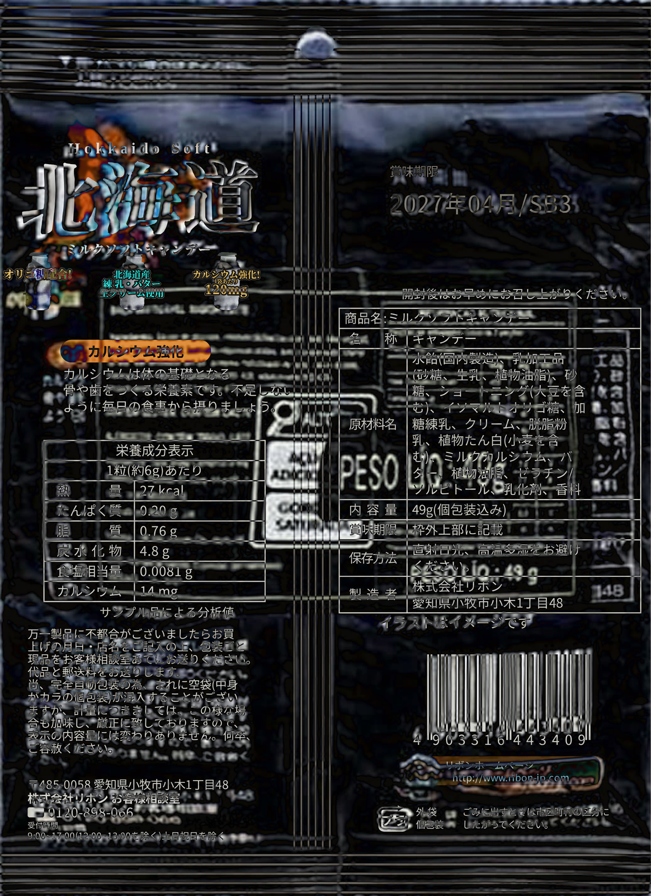

A difference frame lays a second layer on a photo in the blend mode `difference`. Where the two layers agree, the frame is black, and where they differ, thin coloured lines show. The examples use the front and the back of the Hokkaido milk candy bag.

## self

The layer `self` is the photo itself, a little larger, moved and turned. The default is `scale="1.006" translate="0.2 0.15" rotate="0.15"`, with `translate` in percent of the frame.

<DifferenceFrame name="hokkaido-milk-front" alt="The front of the Hokkaido milk candy bag" />

`<DifferenceFrame name="hokkaido-milk-front" />`

<DifferenceFrame name="hokkaido-milk-front" scale="1.02" translate="0 0" rotate="0" />

`<DifferenceFrame name="hokkaido-milk-front" scale="1.02" translate="0 0" rotate="0" />`

<DifferenceFrame name="hokkaido-milk-front" scale="1" translate="0.6 -0.4" rotate="0" hue-rotate="40" />

`<DifferenceFrame name="hokkaido-milk-front" scale="1" translate="0.6 -0.4" rotate="0" hue-rotate="40" />`

## text

The layer `text` sets the text of the bag again, in the boxes that OCR found and that were corrected by hand, in Noto Serif JP and Noto Sans JP. A box with a background colour covers the old letters, so both outlines show. The three large characters have no background colour, so only the parts of the new letters that miss the old ones show.

<DifferenceFrame name="hokkaido-milk-front" layer="text" />

`<DifferenceFrame name="hokkaido-milk-front" layer="text" />`

Other texts in the same boxes:

<DifferenceFrame name="hokkaido-milk-front" layer="text" :texts="{ north: '東', sea: '京', road: '都', hokkaido: 'Tokyo', candy: 'ミルクハードキャンデー' }" />

`<DifferenceFrame name="hokkaido-milk-front" layer="text" :texts="{ north: '東', sea: '京', road: '都', hokkaido: 'Tokyo', candy: 'ミルクハードキャンデー' }" />`

No text at all. The boxes with a background colour then show the old letters bright on it:

<DifferenceFrame name="hokkaido-milk-front" layer="text" texts="" />

`<DifferenceFrame name="hokkaido-milk-front" layer="text" texts="" />`

## trace

The layer `trace` is the photo traced into a colour SVG with few colours (33 KB for the front). The trace loses the creases and the fine print, which show as thin lines. Layers can be stacked, lowest first: `layer="trace text"`.

<DifferenceFrame name="hokkaido-milk-front" layer="trace" />

`<DifferenceFrame name="hokkaido-milk-front" layer="trace" />`

<DifferenceFrame name="hokkaido-milk-front" layer="trace text" />

`<DifferenceFrame name="hokkaido-milk-front" layer="trace text" />`

<DifferenceFrame name="hokkaido-milk-back" layer="trace text" />

`<DifferenceFrame name="hokkaido-milk-back" layer="trace text" />`

## A layer of your own

The default slot holds a layer in HTML or SVG. It lies on a copy of the photo, so the frame is black where the slot paints nothing. Place its content in percent of the frame.

<DifferenceFrame name="hokkaido-milk-front">
  <span class="absolute left-[10.5%] top-[9%] w-[21%] h-[3%] bg-[#a3262a] rounded-full" />
  <span class="absolute left-[12%] top-[25%] w-[78%] h-[17%] border-4 border-black" />
  <span class="absolute left-[14%] top-[61%] w-[70%] h-[27%] bg-white rounded-[45%]" />
</DifferenceFrame>

```html
<DifferenceFrame name="hokkaido-milk-front">
  <span class="absolute left-[10.5%] top-[9%] w-[21%] h-[3%] bg-[#a3262a] rounded-full" />
  <span class="absolute left-[12%] top-[25%] w-[78%] h-[17%] border-4 border-black" />
  <span class="absolute left-[14%] top-[61%] w-[70%] h-[27%] bg-white rounded-[45%]" />
</DifferenceFrame>
```

## Overlay

With `difference="false"`, the layers lie on the photo at the opacity `opacity`. This shows whether the text boxes sit on the letters.

<DifferenceFrame name="hokkaido-milk-front" layer="text" difference="false" opacity="60" />

`<DifferenceFrame name="hokkaido-milk-front" layer="text" difference="false" opacity="60" />`

## Small frames

The bag at the size of a word: <DifferenceFrame name="hokkaido-milk-front" scale="1.03" class="inline-block w-16 align-middle" /> on itself, <DifferenceFrame name="hokkaido-milk-front" layer="text" class="inline-block w-16 align-middle" /> with its text, <DifferenceFrame name="hokkaido-milk-front" layer="trace" class="inline-block w-16 align-middle" /> with its trace and <DifferenceFrame name="hokkaido-milk-back" layer="trace text" class="inline-block w-16 align-middle" /> from the back. A frame of 4rem asks for the image file of 160 pixels, unless the browser already has a larger file of the same image. At this size, the default change of `self` moves the photo by less than a pixel, so the first frame uses `scale="1.03"`.

```html
<DifferenceFrame name="hokkaido-milk-front" scale="1.03" class="inline-block w-16 align-middle" />
<DifferenceFrame name="hokkaido-milk-front" layer="text" class="inline-block w-16 align-middle" />
<DifferenceFrame name="hokkaido-milk-front" layer="trace" class="inline-block w-16 align-middle" />
<DifferenceFrame name="hokkaido-milk-back" layer="trace text" class="inline-block w-16 align-middle" />
```

<DifferenceFrame name="hokkaido-milk-back" layer="trace text" drift class="float-right w-32 ml-4 mb-2" />

A frame can also float beside the text, here with `drift`, which moves the layers slowly by less than a pixel. The text runs around the frame.

`<DifferenceFrame name="hokkaido-milk-back" layer="trace text" drift class="float-right w-32 ml-4 mb-2" />`

<div class="clear-both" />

## The recreations

For comparison, the difference images of the hand-made recreations of the bag from [Suzuno differences](/notes/2610-suzuno-differences).




