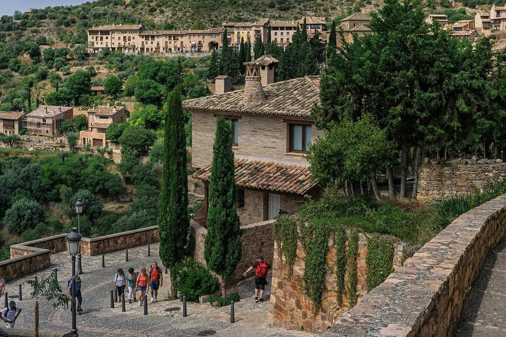

<div class="relative">



The grain on this note comes from the `FilmGrain` component. It is the grain of a scanned 35 mm photo on Kodak Portra 400, as it looks when the frame fills the screen. The short side of the frame then covers about 1200 device pixels, so each device pixel shows about 20 µm of film, and the grain is about as large as one device pixel.

The grain is strongest in the darker midtones of the photo and weak in the highlights, like in the scans. The white of the page stays clean like a bright sky, and the black of the page gets a little grain. The grain belongs to the note and moves with it when the page scrolls, like the grain of a print. A positioned box around the note holds it.

<FilmGrain />
</div>

## Use

```vue
<!-- Over the window: the grain stays in place when the page scrolls -->
<FilmGrain fixed />

<!-- Over a positioned box, with the grain of Tri-X, enlarged twice -->
<div class="relative">
  
  <FilmGrain stock="tri-x-400" :size="2" />
</div>
```

- `stock`: the film (`portra-400`). Each stock sets fine or clumped grain, colour or monochrome grain, and the strength.
- `strength`: replaces the strength of the stock, from 0 to 1.
- `size`: the enlargement of the grain (1). Whole numbers keep the grain sharp.
- `fixed`: cover the window instead of the parent.

| Stock         | Grain         | Midtone σ | Data sheet   |
| ------------- | ------------- | --------- | ------------ |
| `ektar-100`   | fine, colour  | 4         | PGI under 25 |
| `portra-400`  | fine, colour  | 6.3       | PGI 37       |
| `gold-200`    | fine, colour  | 8         | PGI 44       |
| `superia-400` | fine, colour  | 11        | RMS 4 (Fuji) |
| `tri-x-400`   | fine, mono    | 14        | RMS 17       |
| `hp5`         | clumped, mono | 11        | none         |

Midtone σ is the standard deviation of the grain in 8-bit levels, in the flattest midtone areas of scans from Wikimedia Commons at the scale of a frame that fills the screen. The Print Grain Index (PGI) of Kodak is for a 4x6 inch print from 35 mm, where 25 is the threshold of visible grain. Kodak and Fujifilm measure RMS granularity in different ways, so the two RMS values do not compare.

The grain itself is plain CSS and five small images in `src/assets/film-grain/`, so other projects can use it without Vue. `pnpm generate:grain` makes the images and the stock presets again.
