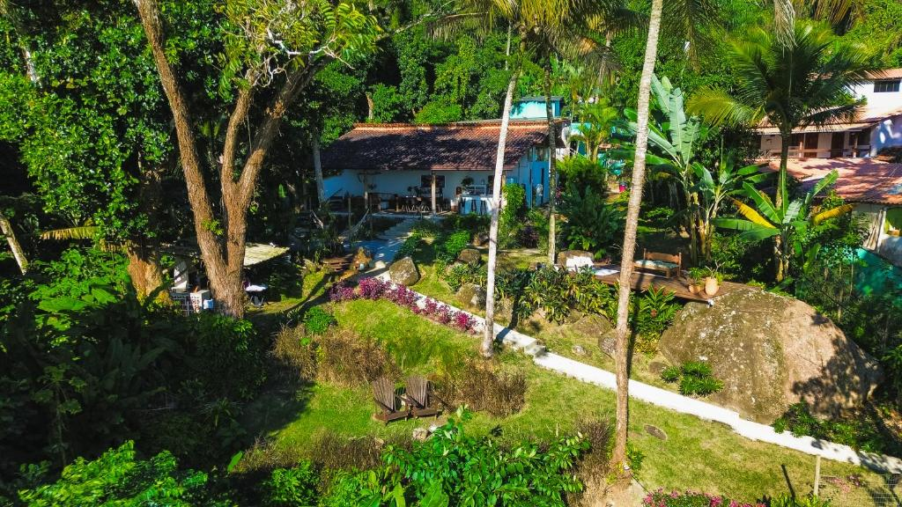

```checklist
you:
- [ ] 2–3 biquínis/maiôs
- [ ] Saída de praia
- [ ] Camisa UV
- [ ] 4 blusas leves
- [ ] 2–3 shorts/saias
- [ ] 1 vestido/conjunto casual leve
- [ ] Pijama e calcinhas
- [ ] Chinelo
- [ ] Tênis
- [ ] Boné/chapéu e óculos de sol
- [ ] Máscara de snorkel
- [ ] Capinha à prova d'água para celular
- [ ] Anticoncepcional
- [ ] Desodorante
- [ ] Lâmina de depilar / prestobarba
- [ ] Escova de dentes e itens de higiene pessoal/absorventes
- [ ] Cabo carregador
- [ ] RG ou CNH

shared:
- [ ] Canga (you)
- [ ] Sun-In (both)
- [ ] Repelente forte (me)
- [ ] Protetor solar (me)
- [ ] Condicionador (me)
- [ ] Pasta de dentes (me)
- [ ] Analgésicos (me)
- [ ] Lanterna de cabeça / headlamp (me)
- [ ] Power bank (me)
- [ ] Sacola para roupa molhada (me)

me:
- [ ] 2–3 shorts (incluindo de banho)
- [ ] Camisa UV / reef shirt
- [ ] 4 blusas leves
- [ ] 1 conjunto casual leve
- [ ] Pijama e cuecas
- [ ] Jaqueta leve (chuva na segunda)
- [ ] Chinelo
- [ ] Sandália / papete
- [ ] Boné/chapéu e óculos de sol
- [ ] Toalha leve
- [ ] Máscara de snorkel
- [ ] Capinha à prova d'água para celular
- [ ] Desodorante
- [ ] Escova de dentes
- [ ] Laptop e carregador
- [ ] Cabo carregador
- [ ] Dinheiro em espécie (R$ 400) e cartões de crédito
- [ ] Passaporte e CRNM
```
