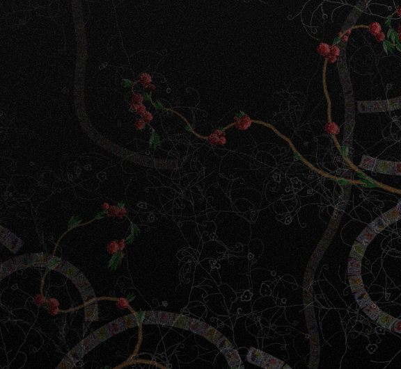
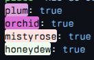
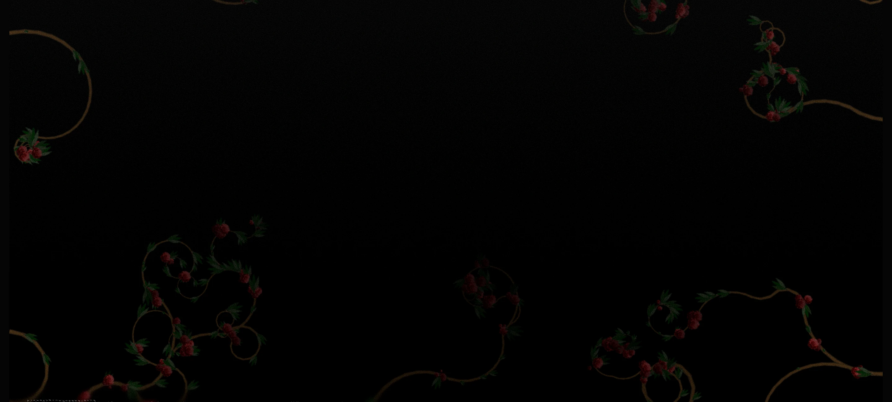
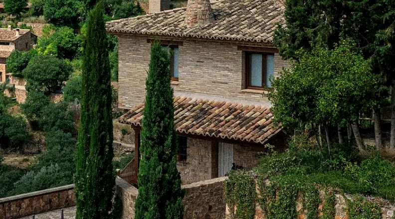

## Plum

Thin branches start at random places on the edges of the window and fork as they grow. Plum comes from the site of [Anthony Fu](https://antfu.me).

## Orchid

Vines with curls, buds and plum blossoms grow from the bottom and the sides. Their shapes come from the ornament on the cover of the Suzuno Financial brochure which the [Suzuno differences](/notes/2610-suzuno-differences) recreate.

<MistyRoseTitle>

## Misty rose

</MistyRoseTitle>

Misty rose grows the rose vines of [Hammerfight](https://en.wikipedia.org/wiki/Hammerfight) (Konstantin Koshutin, 2009).

## Honeydew

Snakes of あべっ子ラムネ candy packets crawl in from the edges, one packet at a time. The packets are the recreations from the [candy differences](/notes/2610-candy-differences). The snakes keep apart from each other, and far snakes are smaller and lighter.

## Grain

